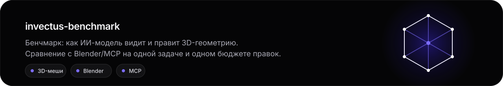

  

## Проекты

  

  

  Один файл, установка не нужна · Windows 10 / 11, 64-бит ·
  <a href="https://github.com/darkandcryssis-eng/evasion-desktop">репозиторий</a> ·
  <a href="https://github.com/darkandcryssis-eng/evasion-desktop/releases/latest">все версии</a>

  

