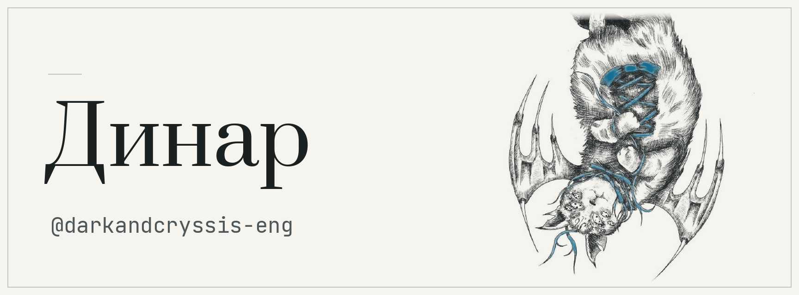

  <picture>
    <source media="(prefers-color-scheme: dark)" srcset="assets/profile-dark.webp">
    
  </picture>

**Сетевые инструменты и десктоп на Go** Go · TypeScript · React · Wails · Windows

## Проекты

### [Evasion](https://github.com/darkandcryssis-eng/evasion-desktop)

Обход блокировок Discord, YouTube и Telegram без VPN. Один .exe, одна кнопка, установка не нужна

Go · Wails + React · WinDivert · Windows 10/11 (x64)

[Скачать Evasion.exe](https://github.com/darkandcryssis-eng/evasion-desktop/releases/latest/download/Evasion.exe) · [Все версии](https://github.com/darkandcryssis-eng/evasion-desktop/releases/latest)

### [Invectus Benchmark](https://github.com/darkandcryssis-eng/invectus-benchmark)

Бенчмарк для ИИ-моделей: как они видят и правят 3D-меши. Сравнение с Blender/MCP на одной задаче и одном бюджете правок
